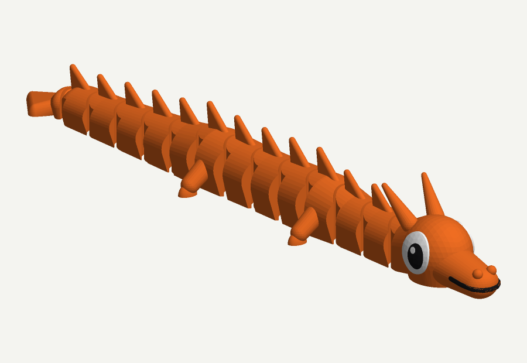

# Big-eye animals (articulated, 3 colours)

Twelve print-in-place animals in the style of the two toys in the photo from 16 Nov 2026: a big white eye, a big black pupil, one white shine dot. Body colour + white + black, nothing else. No supports.




**Status: modelled and sliced, not printed yet.** Print `joint-test.3mf` first (18 min, 3 g).

## The animals

| Animal | Size (mm) | What moves | Slice time | Filament used* |
|---|---|---|---|---|
| Chameleon (from the photo) | 78 × 29 × 25 | 3 body joints, curled tail | 4 h 29 m | 60 g |
| Parrot (from the photo) | 57 × 32 × 41 | top half spins, tail wags | 4 h 47 m | 67 g |
| Dragon | 89 × 30 × 27 | 4 body joints | 4 h 32 m | 61 g |
| Axolotl | 75 × 33 × 19 | 3 body joints | 3 h 53 m | 52 g |
| Shark | 79 × 35 × 26 | 3 body joints | 4 h 16 m | 57 g |
| Owl | 49 × 33 × 38 | top half spins, tail wags | 4 h 29 m | 63 g |
| Alligator | 108 × 29 × 16 | 5 body joints | 4 h 9 m | 56 g |
| Turtle | 78 × 46 × 18 | head turns, tail wags | 4 h 11 m | 58 g |
| Panda (white + black only) | 43 × 34 × 37 | top half spins, tail wags | 7 h 6 m | 106 g |
| Flexi dragon (long, classic maker style) | 210 × 33 × 25 | 13 body joints | 5 h 19 m | 77 g |
| Cat (sitting) | 52 × 32 × 40 | top half spins, tail wags | 6 h 24 m | 90 g |
| Dog (sitting) | 49 × 36 × 34 | top half spins, tail wags | 6 h 5 m | 84 g |

\* Bambu Studio's own estimate for **one** animal alone on the plate (A1, 0.4 nozzle, 0.20 mm, 3 walls, 15% infill). Each small animal is at most 13–19 cm³ of plastic (16–23 g if it were solid); the long flexi dragon is 32 cm³. The rest is the purge from about 55 colour changes and the prime tower. That purge is per plate, not per animal, so **fill the plate with copies of the same animal**: the time and waste barely go up.

Wings (dragon, parrot, owl), legs, arms, horns and gills are fixed. They do not move.

**Panda:** two spools only, white in slot 1 and black in slot 3 (the eye white prints from slot 1). It is slow and wasteful alone because black is in almost every layer (arms, feet, eye patches, ears): about 90 colour changes.

**Cat and dog (added 17 Nov 2026):** sitting, in the same two-piece style as the owl and panda. Cat: pointy ears with white insides, white cheeks and paws, black nose, long curled tail. Dog: black floppy ears, a black patch round one eye, white muzzle, big black nose, short up-curled tail. About 19 cm³ of plastic each (23–24 g). The rest of the slicer figure is purge: white (cat paws, dog muzzle) and black (dog ears) show up in many layers, so fill the plate with copies to share it.

**Flexi dragon:** an original model in the style of the long flexi dragons many makers print: 14 links, one back plate per link, swept horns, arrow tail, no wings. 210 mm long, so it sits straight on the A1 plate.

## Files

| File | Use |
|---|---|
| `<animal>.3mf` | Open in Bambu Studio (File → Open Project). Colours are already on slots 1 = body, 2 = white, 3 = black. |
| `stl/<animal>-body.stl`, `-white.stl`, `-black.stl` | The same three parts for any slicer. Load all three together "as one object with multiple parts" so they stay lined up. |
| `stl/<animal>-one-colour.stl` | The whole animal as one mesh, for a fast single-colour print (about 1 h, no purge). |
| `joint-test.3mf` | Two plain links with one joint. |
| `previews/` | Pictures: 3/4 view, side, top, front, and underside with each moving piece in its own colour. |

## Printing (Bambu Studio, A1 + AMS Lite)

1. Load body colour in slot 1, white in slot 2, black in slot 3. Change the slot 1 colour in the project to match your spool.
2. Leave brim **off**. A brim fills the 0.45 mm joint gaps on the first layer.
3. Leave the prime tower on. No supports.
   **Support check, 17 Nov 2026: all 13 pass with supports off** (layer-by-layer check in `_generator/supports.mjs` + Bambu Studio CLI, no floating-region warnings). Fixed on the way: a flat ceiling over every joint's tongue slot (now a 45° tent; flat 3 mm bridge at the tail joint), wing/arm tips that started in mid-air (parrot, owl, panda: now rest on the plate), the last back spike on the chameleon and dragon, the cat's nose tip, the dog's and cat's tail balls. Re-run with `node supports.mjs`.
4. To print several: right-click the animal → Clone, then Arrange.
5. Purge amounts are set by hand (550 mm³ into white). To use Bambu's own numbers, open Flushing Volumes → Auto-Calc.
6. After printing, wiggle each joint sideways to free it. Twist the birds at the waist.

## How the joint works

Each link has a 4 mm vertical pin standing in a pocket with a 45° tented roof. The next link has a flat 3 mm ring around the pin. Gap 0.45 mm all round, 0.6 mm above. The slot the tongue swings in also has a 45° tent roof (from 17 Nov 2026); where a link is too low for the full tent (the tail joint, the birds' rump), the build picks a short flat cap or cone that the support check passes. Each joint swings 24° left and right (checked by rotating the meshes and testing for overlap).

The birds' top half sits on a 45° cone seat with a 0.7 mm gap. A shaft runs down to the plate and flares out so it can't lift off.

If the joint test is fused or too loose, change `J` at the top of `_generator/lib.mjs` and rebuild.

## Rebuilding

```
cd _generator
npm install
node build.mjs            (all)   or   node build.mjs dragon
node sheet.mjs            (the group picture, previews/family.png)
```

`animals.mjs` holds the designs, `lib.mjs` the joint, the eye and the checks, `mf.mjs` the Bambu project writer. The `.3mf` takes its printer and filament settings from any 3-filament A1 project saved from Bambu Studio (set `BAMBU_TEMPLATE`; default is `Downloads\Cardboard Perforation Tool.3mf`). `report.json` lists, per animal: piece count, joint swing, wall thickness around each pocket, steep-overhang area, and the slot roof used at each joint (`roofCap`). `node supports.mjs` slices every animal at 0.2 mm and lists anything floating, any cantilever, and any bridge (writes `supports.json`).

Built with manifold-3d instead of OpenSCAD: OpenSCAD 2021 was too slow for the rounded shapes.
