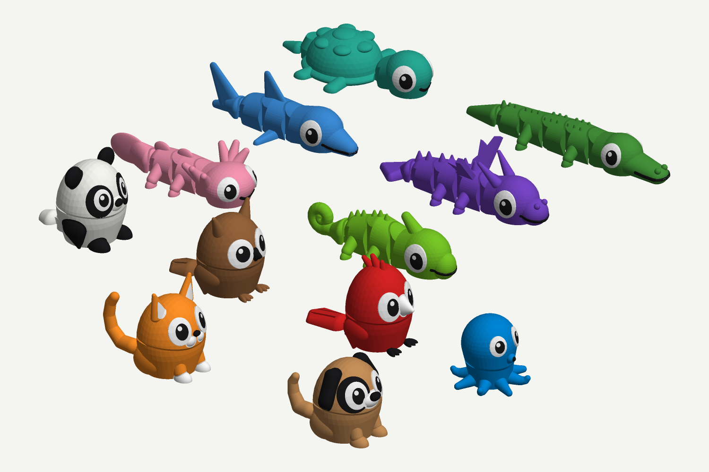
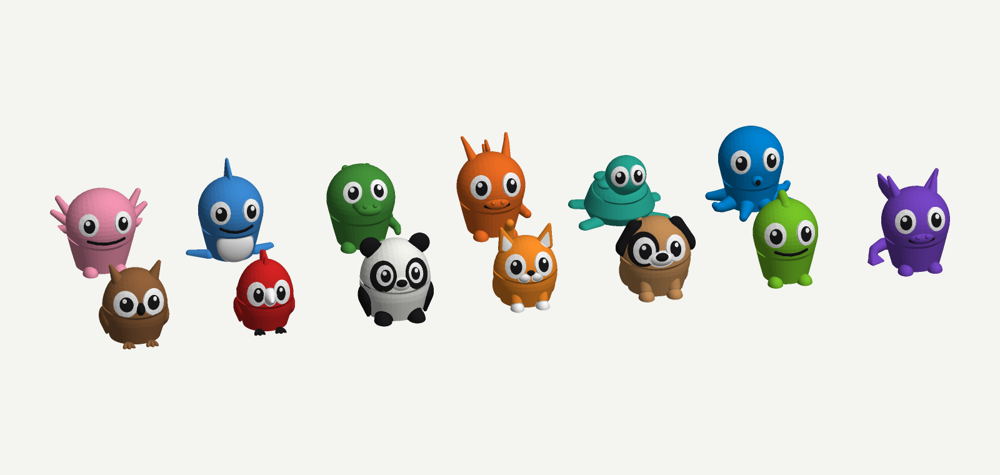
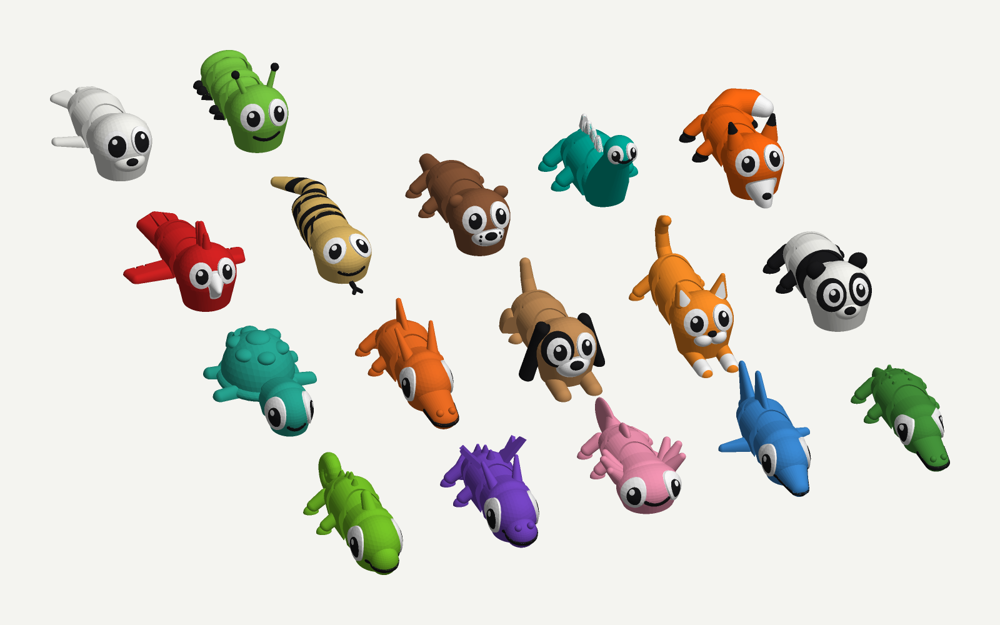

# Big-eye animals (articulated, 3 colours)

Twelve print-in-place animals in the style of the two toys in the photo from 16 Nov 2026: a big white eye, a big black pupil, one white shine dot. Body colour + white + black, nothing else. No supports.




**Status: the first print (a dragon, 17 Nov 2026) came apart at every joint. The joint was redesigned the same day (locking pin, see "How the joint works") and every model rebuilt. Print the new `joint-test.3mf` first (about 18 min, 3 g) and pull on it before printing anything else.**

## The animals

| Animal | Size (mm) | What moves | Slice time | Filament used* |
|---|---|---|---|---|
| Chameleon (from the photo) | 78 × 29 × 25 | 3 body joints, curled tail | 4 h 29 m | 60 g |
| Parrot (from the photo) | 57 × 32 × 41 | top half spins, tail wags | 4 h 47 m | 67 g |
| Dragon | 89 × 30 × 27 | 4 body joints | 4 h 32 m | 61 g |
| Axolotl | 75 × 33 × 19 | 3 body joints | 3 h 53 m | 52 g |
| Shark | 79 × 35 × 26 | 3 body joints | 4 h 16 m | 57 g |
| Owl | 49 × 33 × 38 | top half spins, tail wags | 4 h 29 m | 63 g |
| Alligator | 108 × 29 × 16 | 5 body joints | 4 h 9 m | 56 g |
| Turtle | 78 × 46 × 18 | head turns, tail wags | 4 h 11 m | 58 g |
| Panda (white + black only) | 43 × 34 × 37 | top half spins, tail wags | 7 h 6 m | 106 g |
| Flexi dragon (long, classic maker style) | 210 × 33 × 25 | 13 body joints | 5 h 19 m | 77 g |
| Cat (sitting) | 52 × 32 × 40 | top half spins, tail wags | 6 h 24 m | 90 g |
| Dog (sitting) | 49 × 36 × 34 | top half spins, tail wags | 6 h 5 m | 84 g |
| Octopus (small) | 33 × 33 × 31 | head spins on the tentacles | 3 h 28 m | 48 g |

\* Bambu Studio's own estimate for **one** animal alone on the plate (A1, 0.4 nozzle, 0.20 mm, 3 walls, 15% infill). Each small animal is at most 13–19 cm³ of plastic (16–23 g if it were solid); the long flexi dragon is 32 cm³. The rest is the purge from about 55 colour changes and the prime tower. That purge is per plate, not per animal, so **fill the plate with copies of the same animal**: the time and waste barely go up.

Wings (dragon, parrot, owl), legs, arms, horns and gills are fixed. They do not move.

**Panda:** two spools only, white in slot 1 and black in slot 3 (the eye white prints from slot 1). It is slow and wasteful alone because black is in almost every layer (arms, feet, eye patches, ears): about 90 colour changes.

**Cat and dog (added 17 Nov 2026):** sitting, in the same two-piece style as the owl and panda. Cat: pointy ears with white insides, white cheeks and paws, black nose, long curled tail. Dog: black floppy ears, a black patch round one eye, white muzzle, big black nose, short up-curled tail. About 19 cm³ of plastic each (23–24 g). The rest of the slicer figure is purge: white (cat paws, dog muzzle) and black (dog ears) show up in many layers, so fill the plate with copies to share it.

**Octopus (added 17 Nov 2026):** the small one, about 1.3 in (33 mm) each way, sized like the store-bought desk octopus figures. Big round head with the usual big eyes and a little "o" snout; eight tentacles flat on the plate, four with curled-up tips. The head spins on the tentacle ring (same cone seat as the owl and panda, no tail joint). Only 11 cm³ of plastic (about 13 g); most of the 48 g figure is purge, so fill a plate with them.

**Flexi dragon:** an original model in the style of the long flexi dragons many makers print: 14 links, one back plate per link, swept horns, arrow tail, no wings. 210 mm long, so it sits straight on the A1 plate.

## Minis (about 1.3 in) and short wigglers (17 Nov 2026)

Small versions of every animal, sized like the store-bought 1–1.4 in desk figures. The joints can't shrink: at 1.3 in the pin and the 0.45 mm gaps would be smaller than a 0.4 mm nozzle prints and would fuse. So there are two kinds of small:



**Minis, about 1.3 in (`<animal>-mini`).** Each one has a spinning top.
- **Round sitters (owl, parrot, panda, cat, dog):** the same designs shrunk to 0.72–0.84. The spin seat and tail joint inside stay full size, so the head still spins and the tail still wags. They come out about 30 mm tall and 40–46 mm long with the tail.
- **Long animals (chameleon, dragon, axolotl, shark, alligator, turtle, flexi dragon):** redesigned as chunky sitting chibis, plus the octopus. The top half spins on the body, and the tail curls round on the plate.
  - Chameleon has its casque and a spiral tail. Dragon has horns, wings and an arrow tail. Axolotl has gills and a tail fin.
  - Shark has a dorsal fin and a white belly. Alligator has a high snout with its eyes on top. Turtle's shell and head spin together. Flexi dragon has swept horns and back plates.
  - Faces sit above the spin line. The cut between the halves is a 45° cone, so anything low and far forward would be sliced off.



**Short wigglers (`<animal>-short`).** The seven long animals with 2 full-size joints, 60–65 mm long (about 2.5 in). The head, tail and trim are shrunk and the body links stay full size. Each joint swings 20–28° each way.

The two-colour dragons (Ridgeback, Puff) have their own mini and short versions in `../two-colour-dragons-clickers/`.

## New poses, new animals and keychains (17 Nov 2026, built in rounds)

Pictures: `previews/shorts.png` (every short), `previews/minis-new.png`, `previews/keychains.png`. Every one here has the locking pin (see "How the joint works").

**Round 1: the round sitters re-posed long, so they can be shorts** (`_generator/poses.mjs`, 2 joints each). The sitters sit up, so they had nowhere to bend; lying or walking they get the same joints as the chameleon.
- **Dog:** lying down, chin on its front paws, floppy black ears resting on the plate, tail up.
- **Cat:** a big stretch: chest low, hips up, front paws (white) reaching forward, tail curled up.
- **Panda:** walking on all fours, black legs, ears and shoulder band.
- **Parrot:** flying: wings spread flat on the plate with feather notches, long tail fan, crest. The wings start behind the neck joint so they clear the head when it swings.
- The owl stays a sitter (no short); the octopus stays a spinner.

**Round 2: new long animals as shorts** (`_generator/poses2.mjs`, 2 joints each): snake (gold with black bands, forked tongue, S-curve tail), otter (brown, white muzzle, whisker dots, flat tail), long-neck dino (teal, neck rises at about 55° so the chin prints without support, white back plates), fox (orange, white snout and tail tip, black ear tips and paws), seal pup (white, flippers flat on the plate), caterpillar (light green, humps, black feet, antennae).

**Round 3: new round minis** (`_generator/minis2.mjs`, top spins like the chibis, nothing to come apart): bunny (pink), hamster (tan, white cheeks and belly), penguin (royal blue, white face and belly), frog (light green, eye bumps on top), hedgehog (brown, spikes on the back half, every spike rising 50°+), chick (gold), pig (pink, curly tail).

**Round 4: winter minis** (`_generator/minis3.mjs`): polar bear (white), reindeer (brown, two-tine antlers), snowman (white snow painted over an orange body, so the hat, scarf and carrot nose are orange; pom-pom white).

**Keychains (`<animal>-keychain`, `_generator/keychain.mjs`).** Every mini (and the octopus) with a teardrop loop on top of the head for a keyring or backpack clip. The loop's point and its hole both rise at 45°, so it prints without support, and it rides on the spinning top, so the head still turns. Adds about 7 mm of height and well under 1 g.

All of these pass the same checks as the big ones: one piece per moving part, no thin walls, no clash when spun, and the support check (`supports.mjs`) finds nothing floating. Slice times and grams: `_generator/slice-report.csv`. As with the big ones, most of the grams for one alone is purge, so fill the plate.

## Files

| File | Use |
|---|---|
| `<animal>.3mf` | Open in Bambu Studio (File → Open Project). Colours are already on slots 1 = body, 2 = white, 3 = black. |
| `stl/<animal>-body.stl`, `-white.stl`, `-black.stl` | The same three parts for any slicer. Load all three together "as one object with multiple parts" so they stay lined up. |
| `stl/<animal>-one-colour.stl` | The whole animal as one mesh, for a fast single-colour print (about 1 h, no purge). |
| `joint-test.3mf` | Two plain links with one joint. |
| `previews/` | Pictures: 3/4 view, side, top, front, and underside with each moving piece in its own colour. |

## Printing (Bambu Studio, A1 + AMS Lite)

1. Load body colour in slot 1, white in slot 2, black in slot 3. Change the slot 1 colour in the project to match your spool.
2. Leave brim **off**. A brim fills the 0.45 mm joint gaps on the first layer.
3. Leave the prime tower on. No supports.
   **Support check, 17 Nov 2026: all 14 pass with supports off** (layer-by-layer check in `_generator/supports.mjs` + Bambu Studio CLI, no floating-region warnings). Fixed on the way: a flat ceiling over every joint's tongue slot (now a 45° tent; flat 3 mm bridge at the tail joint), wing/arm tips that started in mid-air (parrot, owl, panda: now rest on the plate), the last back spike on the chameleon and dragon, the cat's nose tip, the dog's and cat's tail balls. Re-run with `node supports.mjs`.
4. To print several: right-click the animal → Clone, then Arrange.
5. Purge amounts are set by hand (550 mm³ into white). To use Bambu's own numbers, open Flushing Volumes → Auto-Calc.
6. After printing, wiggle each joint sideways to free it. Twist the birds at the waist.

## How the joint works

Each link has a vertical pin standing in a pocket with a 45° tented roof. The next link has a 3 mm ring around the pin. Gap 0.45 mm all round, 0.6 mm above.

**Locking pin (17 Nov 2026).** The first printed dragon came apart at every link: the pin was a straight 4 mm post and the ring sat on the plate with nothing under it, so lifting a link slid it straight off. The pin now bulges in the middle (3.2 mm at the base and top, 5.4 mm across the bulge, 45° slopes so no support), and the ring's hole is the same shape 0.45 mm bigger all round. The ring is trapped above and below; a link can move about 0.6 mm up or down, then the bulge catches. The ring and pocket grew 0.25 mm to keep the ring wall over 1 mm. Every jointed model (all the animals, minis, shorts and the two-colour dragons) was rebuilt with it. Files from before this date have the old joint: reprint the joint test first. The slot the tongue swings in also has a 45° tent roof (from 17 Nov 2026); where a link is too low for the full tent (the tail joint, the birds' rump), the build picks a short flat cap or cone that the support check passes. Each joint swings 24° left and right (checked by rotating the meshes and testing for overlap).

The birds' top half sits on a 45° cone seat with a 0.7 mm gap. A shaft runs down to the plate and flares out so it can't lift off.

If the joint test is fused or too loose, change `J` at the top of `_generator/lib.mjs` and rebuild.

## Rebuilding

```
cd _generator
npm install
node build.mjs            (all)   or   node build.mjs dragon
node sheet.mjs            (the group picture, previews/family.png)
node sheet-minis.mjs      (previews/minis.png and shorts.png)
```

`animals.mjs` holds the designs (`minis.mjs` the minis, `short.mjs` the short wigglers, `catalog.mjs` lists them all), `lib.mjs` the joint, the eye and the checks, `mf.mjs` the Bambu project writer. The `.3mf` takes its printer and filament settings from any 3-filament A1 project saved from Bambu Studio (set `BAMBU_TEMPLATE`; default is `Downloads\Cardboard Perforation Tool.3mf`). `report.json` lists, per animal: piece count, joint swing, wall thickness around each pocket, steep-overhang area, and the slot roof used at each joint (`roofCap`). `node supports.mjs` slices every animal at 0.2 mm and lists anything floating, any cantilever, and any bridge (writes `supports.json`).

Built with manifold-3d instead of OpenSCAD: OpenSCAD 2021 was too slow for the rounded shapes.
