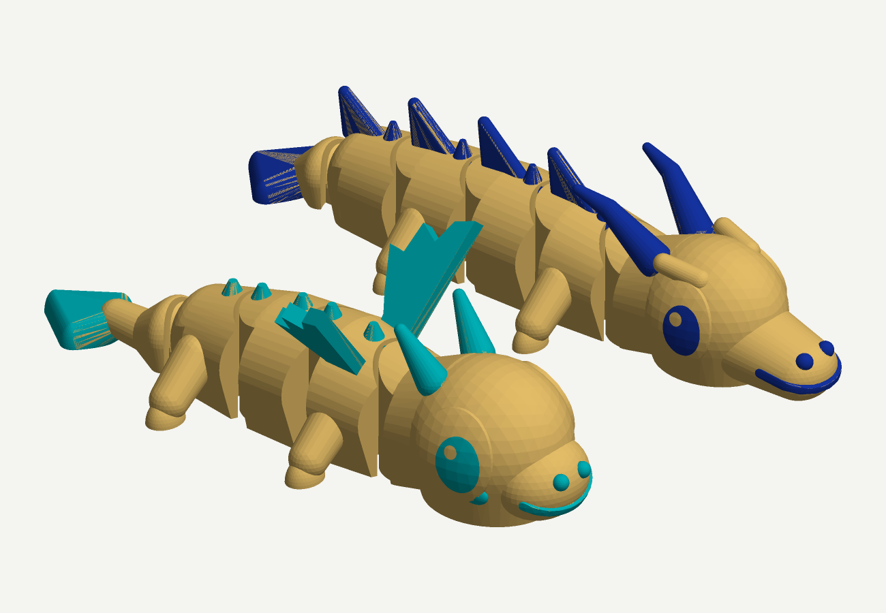
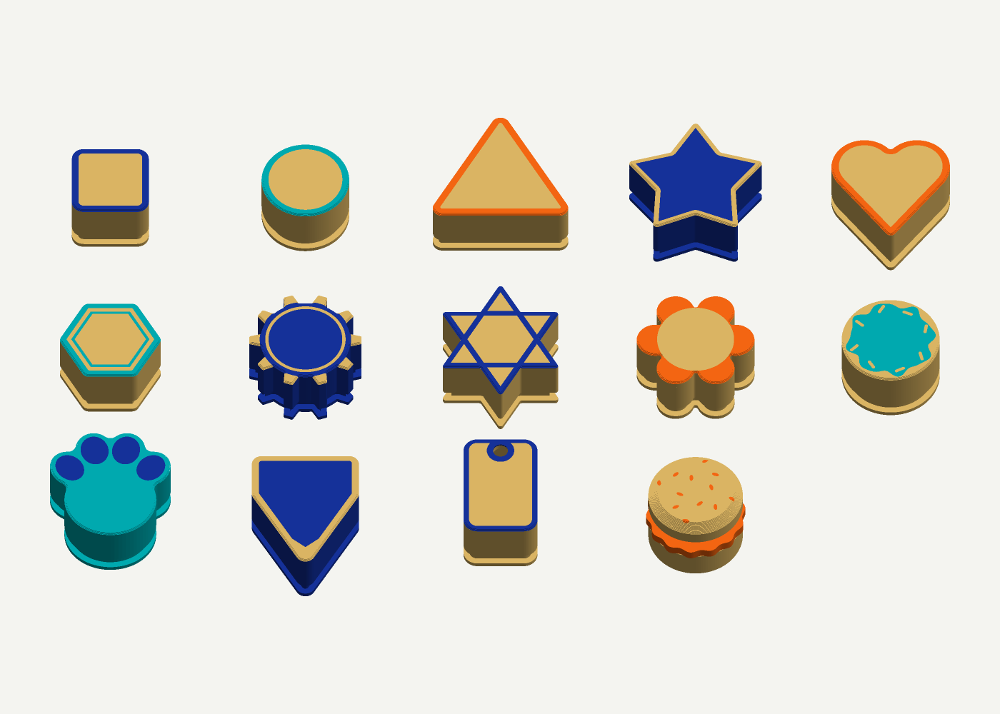
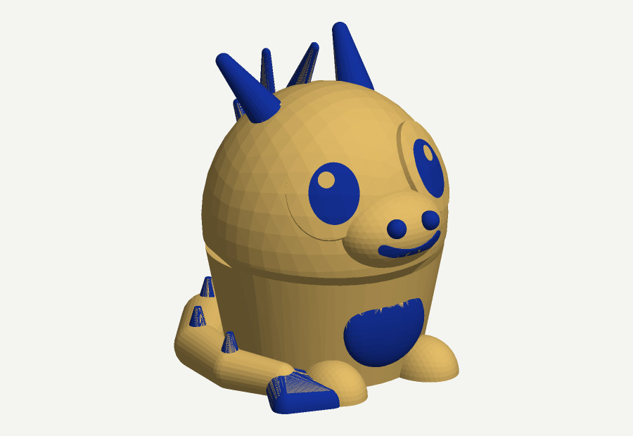
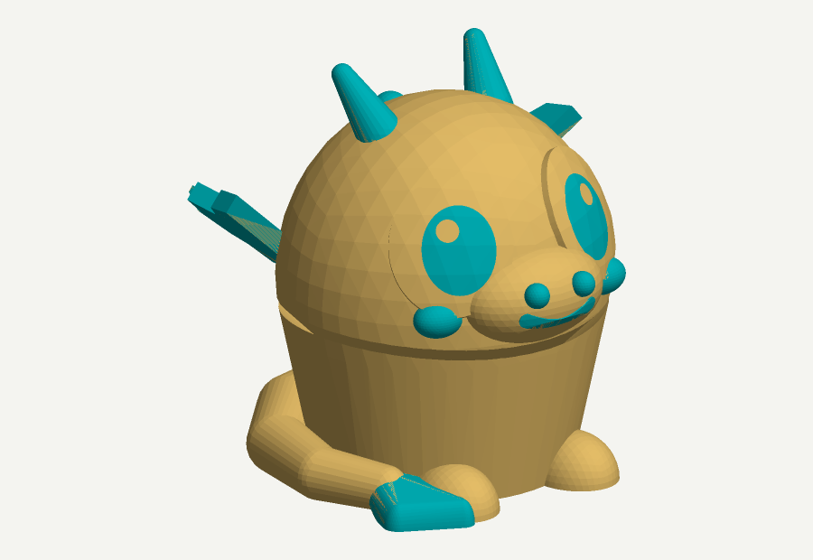
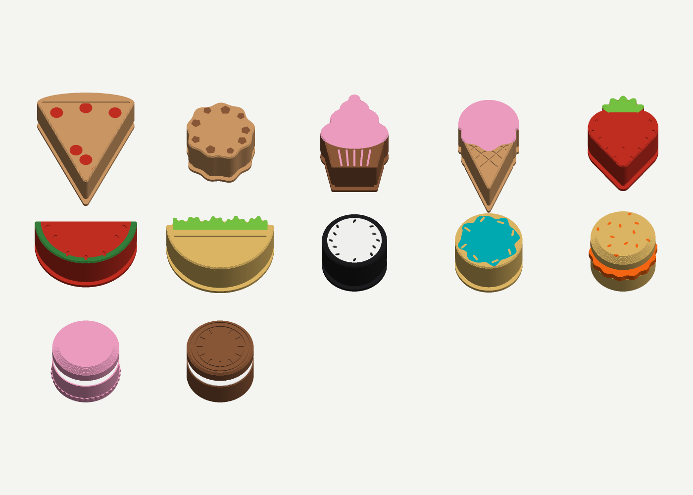
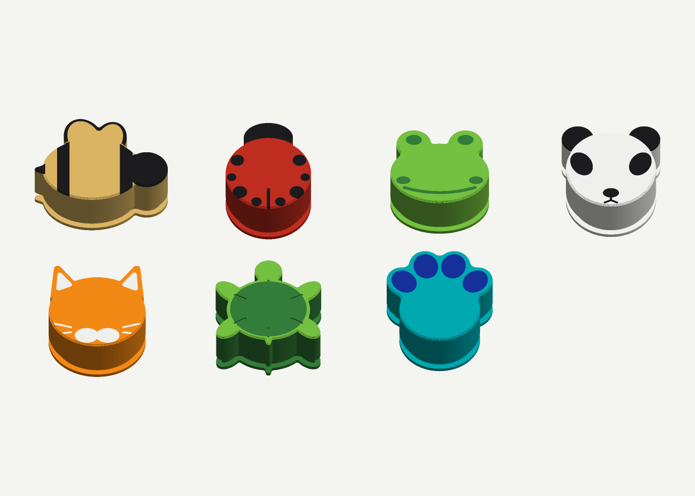
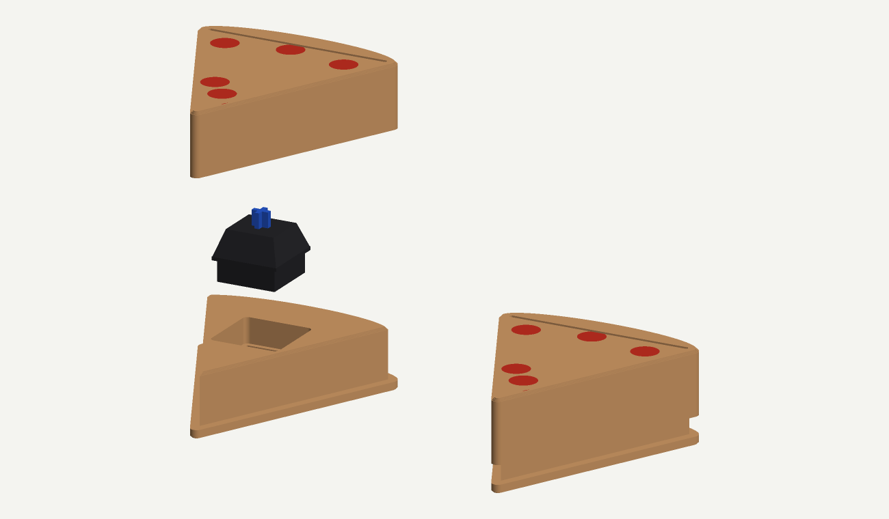
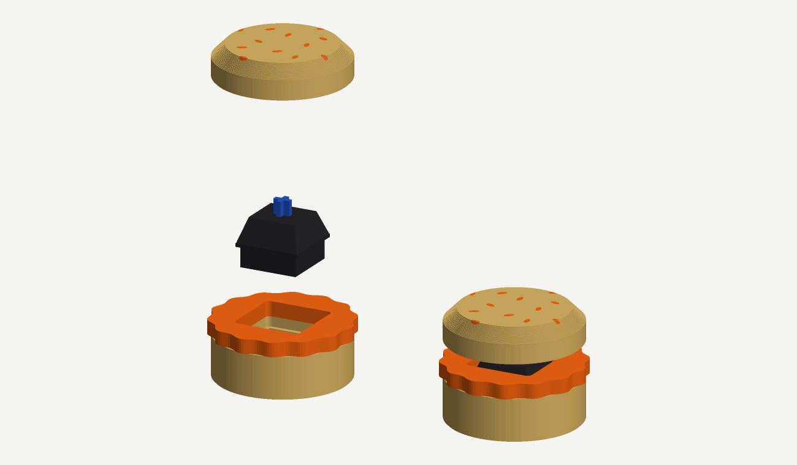

# Two-colour dragons + switch clickers

Built 17 Nov 2026. Original designs, **two colours only** (slot 1 = body, slot 2 = accent), so they run off the spools already on the AMS: gold (full), orange, royal blue, turquoise (about a fifth each). **Modelled and sliced, not printed yet.**





## Dragons (4 inches, print-in-place, no supports)

| Dragon | Size (mm) | Moves | Accent parts | Default colours |
|---|---|---|---|---|
| **Ridgeback** | 103 × 32 × 24 | 5 joints, 24° each way | horns, 4 ridge plates + 4 spikes, spade tail, pupils, nostrils, smile | gold + royal blue |
| **Puff** (winged baby) | 95 × 36 × 30 | 4 joints, 24° each way | wings, horns, back nubs, flame tail, pupils, cheeks, nostrils, smile | gold + turquoise |

Same joint as `../big-eye-animals` (pin in a tented pocket, 0.45 mm gap). **Locking pin from 17 Nov 2026:** the first printed dragon came apart at every link (the old straight pin let a link lift off), so the pin now bulges in the middle and the ring's hole matches it; the ring can't slide off up or down. All four dragons and their minis and shorts were rebuilt with it. Print the new `../big-eye-animals/joint-test.3mf` first and pull on it. The last joint on Ridgeback and Puff has a slightly thinner skin over the pocket (under 1 mm³ less than 0.8 mm thick): fine, but the first place to look if a tail ever cracks. Wings and horns are fixed. After printing, wiggle each joint sideways to free it.

**Support check, 17 Nov 2026: both dragons and all 30 clickers (+ both fit tests) pass with supports off** (layer-by-layer check from `../big-eye-animals/_generator/supports.mjs` + Bambu Studio CLI: no floating-region warnings). Fixed: the flat ceiling over each joint's tongue slot (now a 45° tent, short flat bridge at Ridgeback's tail joint), Puff's tail end hovering 0.6 mm over the plate, and the cookie-sandwich cap's outer dimple ring (moved 0.5 mm in; the rim outside it floated). Left as is on purpose: the 0.85 mm ledge under the switch plate (the switch clips need it) and the 1–2 mm roofs over the dimples printed face-down on the caps.

### Colour rotation (12 looks before a repeat)

| Look | Ridgeback | Puff |
|---|---|---|
| 1 | gold + royal blue | gold + turquoise |
| 2 | gold + turquoise | gold + orange |
| 3 | gold + orange | royal blue + orange |
| 4 | royal blue + orange | turquoise + orange |
| 5 | turquoise + orange | royal blue + turquoise |
| 6 | royal blue + turquoise | gold + royal blue |

Change looks by changing which spool feeds slot 1 and slot 2 (and the slot colours in Bambu Studio so the preview matches). Gold as the body uses the big spool; the partial spools only do accents.

### Small versions (17 Nov 2026)

 

| File | Size (mm) | Moves |
|---|---|---|
| `dragons/ridgeback-mini.3mf` | 30 × 28 × 33 (1.3 in) | head spins; spade tail curled round on the plate |
| `dragons/puff-mini.3mf` | 30 × 35 × 33 | head spins; wings, flame tail |
| `dragons/ridgeback-short.3mf` | 57 × 28 × 20 | 2 joints, 24–28° each way |
| `dragons/puff-short.3mf` | 60 × 29 × 23 | 2 joints, 24–28° each way |

The joints can't shrink to 1.3 in (the gaps would fuse), so each dragon has a **mini** and a **short** version. The mini is a sitting baby dragon whose head spins on the body. The short version keeps 2 full-size joints and shrinks everything else. Same two colours and slots as the big ones. Designs: `_generator/dragons-mini.mjs`.

## Switch clickers (two-piece, no keycap)

Rebuilt 17 Nov 2026: **no keycap**. Each clicker is two printed halves in the shape of the thing itself. The bottom half (base) holds one MX-style keyboard switch. The top half (cap) is the top of the pizza / frog / burger and presses straight onto the switch stem with a printed cross socket, the way a keycap would. Press anywhere on the top and it clicks.





Two styles:

| Style | Used for | How it looks |
|---|---|---|
| **Hidden lid** | everything except the sandwiches | The base has a full-outline foot and a slightly smaller neck around the switch. The cap's skirt slides over the neck (0.45 mm gap), so you never see the switch: it looks like one solid shape on a matching foot, and sinks 4 mm when pressed. The skirt also keeps big caps from tipping. |
| **Visible split** | hamburger, macaron, cookie sandwich | Both halves are full outline with a 4.5 mm gap that closes when pressed, like squeezing a sandwich. The filling (patty, cream) is the top of the base. |

Heights come from the Cherry MX datasheet (switch housing 6.6 mm above the plate, stem top 10.2 mm, 4 mm travel). The build checks every clicker: base and cap are one piece each, and they do not touch at rest or fully pressed.

**Made smaller (17 Nov 2026).** The bases are built for a switch with its **pins clipped** (see Assembly), which takes 4 mm off every clicker. Lid clickers are now 21.5 mm tall (were 25.5); the sandwiches 24–26 mm (were 28–30). Every outline is also capped at 38 mm across, and the well around the switch is narrower (16.4 mm, since the switch now pushes out through a hole in the floor instead of needing room for a puller). Pointy and long shapes can't reach 38 mm because the square switch has to fit inside their narrowest part: pizza 48 × 54, taco 53 × 32, bee 51 × 38, watermelon 50 × 25, ice cream 30 × 53, triangle 46 × 41, star 45 × 43 mm. Everything else is 25–40 mm.

The build sizes each design itself: it shrinks anything over 38 mm, then grows it in 2% steps until the switch and the neck fit (`MAXW` and `scale` in `report.json`).

| Group | Clickers (body + accent) |
|---|---|
| Shapes | square (gold + royal blue), circle (gold + turquoise), triangle (gold + orange), star (royal blue + gold), heart (gold + orange), hexagon (gold + turquoise), gear (royal blue + gold), Star of David (gold + royal blue), flower (gold + orange), shield (royal blue + gold), keychain tag (gold + royal blue, ring hole) |
| Food, hidden lid | pizza (tan + red), cookie (tan + brown), cupcake (brown + pink), ice cream (tan + pink), strawberry (red + light green), watermelon (red + dark green), taco (gold + light green), sushi (black + white), donut (gold + turquoise) |
| Food, visible split | hamburger (gold + orange patty and seeds), macaron (pink + white cream), cookie sandwich (brown + white cream) |
| Animals | bee (gold + black), ladybug (red + black), frog (light + dark green), panda (white + black), cat face (pumpkin orange + white), turtle (dark + light green), paw (turquoise + royal blue) |

Seeds, crust and waffle lines, the taco fold, sushi rice, the cookie-sandwich pattern and turtle shell lines are shallow dimples (0.6 mm) rather than a third colour.

### Before the first batch: two quick fit tests

1. **`switch-fit-test`** (13 min): a bar with square holes 13.9 / 14.0 / 14.1 / 14.2 mm (1–4 notches). Snap a switch into each. The bases use 14.1 (notch 3). If another fits better, set `HOLE` at the top of `_generator/clickers.mjs`.
2. **`stem-fit-test`**: four socket posts with cross arms 1.20 / 1.25 / 1.30 / 1.35 mm wide (1–4 notches). Push each onto a switch stem. Pick the one that grips firmly but still goes on by hand. The caps use 1.30 (notch 3); to change it, set `CROSS_W` in `TWO` in `_generator/clickers.mjs` and rebuild.

### Printing

Each `.3mf` has the base (upright) and the cap (upside down, top face on the bed) side by side on one plate, both two-colour. No supports, no brim. The cap's two-colour design is in its first layers, so the top comes out smooth from the plate.

### Assembly





0. **Clip the pins first.** With flush side cutters, snip both metal pins and the round plastic post under the switch (and the two small side posts if it is a 5-pin switch) flush with the bottom. About 10 seconds per switch. An unclipped switch is 3.3 mm too tall for the base.
1. Push the switch **straight into the square hole** in the base until both side clips snap under the plate. Any of the four rotations works.
2. Line the cap up with the base (same outline) and press it **straight down** onto the switch stem until it seats. The cross socket only goes on two ways (180° apart): turn the cap a quarter turn if it won't go.
3. Press and release a few times: it should click and spring back without rubbing. If the skirt rubs, sand the inside of the skirt lightly.
4. To take it apart: pull the cap straight up, then push the switch out from underneath through the 5 mm hole in the floor (a pen or a small screwdriver).

## Parts to buy (per clicker: 1 switch; keychain parts optional)

No keycaps needed any more. Checked 17 Nov 2026 from search results only: prices, seller ratings, exact pack counts and shipping were **not** checked. Confirm on each listing before ordering.

| Part | What to get | Listing |
|---|---|---|
| **Switches** | Any full-height MX-style switch, 3-pin or 5-pin (both fit the pocket). **Blue = clicky**, the fidget sound most kids want; brown = soft bump; red = silent and smooth. **Not** low-profile or "half height" switches. | [Outemu MX 3-pin switches, sold in 100s](https://www.aliexpress.us/item/3256802604448381.html) · [Gateron MX 3/5-pin, 65/92/110 packs](https://www.aliexpress.us/item/2251832611288253.html) · backup on Amazon: [Gateron G Blue Pro 3.0, 90 pcs](https://www.amazon.com/GATERON-Pre-lubed-Keyboard-Clicky-Mechanical/dp/B0DMPK6NR8) |
| **Keychain parts** | Split ring + short chain + jump ring. Today only the **keychain tag** has a ring hole; the others need a loop added before they can hang on a keychain. | [100-set key rings with chain + jump rings](https://www.aliexpress.us/item/3256803850885316.html) · [split rings with jump ring, 10/50/100](https://www.aliexpress.us/item/3256806353963590.html) |
| **Tools** | Flush side cutters for clipping the switch pins (any electronics or hobby flush cutter); small pliers for jump rings. | |

Avoid: "Outemu half height / dwarf", "low profile", "GTMX" and magnetic switches. The base is built for the full-height MX size.

Slice times and grams for every file: `_generator/slice-report.csv` (Bambu Studio estimate, A1, one clicker alone on the plate, purge included). Fill a plate with copies to share the purge.

## Files

| File | Use |
|---|---|
| `dragons/<name>.3mf` | Dragon projects (A1, 0.20 mm, 3 walls, 15% infill, no brim, no supports, prime tower on). Slot 1 = body, slot 2 = accent; slot 3 unused. |
| `clickers/<name>.3mf` | Clicker projects: base + cap on one plate, same settings and slots. |
| `stl/<name>-body.stl` + `-accent.stl` | The two colour parts for the Kobra S1 / any slicer: load together as one object with multiple parts (clickers: base and cap are already laid out side by side in them). |
| `stl/<name>-one-colour.stl` | Everything as one mesh, for a fast single-colour print. |
| `previews/` | Pictures. Dragons: 3/4, side, top, underside with each link in its own colour. Clickers: assembled 3/4 and top, `-plate` (print layout), `-section` (cut through base and cap), `assembly-*`. |

## Ideas: more colourways and clicker icons (17 Nov 2026, not built)

Uses every colour on the `../FILAMENT.md` list, assuming all are bought: white, black, gold, royal blue, turquoise, orange, red, purple, pink, sky blue, brown, tan, grey, light green and dark green. (Turquoise and teal, and the three oranges, are close enough to count as one each.) Still two colours per piece.

### New colourways for what is already built

| Design | Colourways (body + accent) |
|---|---|
| Ridgeback dragon | dark green + gold · red + black · black + red · white + sky blue (ice dragon) · purple + gold |
| Puff dragon | purple + pink · pink + white · sky blue + white · orange + brown · light green + dark green |
| Heart | red + pink · pink + white · purple + pink |
| Flower | white + gold (daisy) · pink + gold · purple + white · gold + brown (sunflower) |
| Donut | tan + pink (strawberry icing) · tan + brown (chocolate) · brown + white |
| Hamburger | tan buns + brown patty (the real look) |
| Star | gold + black · white + sky blue · red + white |
| Star of David | white + royal blue (flag colours) · sky blue + white |
| Hexagon | gold + black (honeycomb) · grey + black |
| Gear | grey + black · black + orange |
| Paw | black + pink · brown + tan · white + pink |
| Shield | red + white · black + gold · purple + gold |
| Circle | black + white (8-ball once a number is added) · orange + black |
| Square / keychain tag | any pair: these are the "school colours" or custom-order blanks |

### New clicker icons the full palette opens up

Every icon needs a centre at least 19 mm across to hold the switch, so thin shapes (a lightning bolt alone, a candy cane) sit on a round or square badge. These are listed by selling occasion.

| Icon | Colours | Why |
|---|---|---|
| **Dreidel** | royal blue + white | Hanukkah starts 4 Dec 2026, so it can be ready for a December school sale |
| **Menorah badge** | royal blue + gold | Hanukkah |
| **Gelt coin** | gold + brown | Hanukkah, cheap and quick |
| **Apple + honey drop** | red + gold | Rosh Hashanah (next fall) |
| **Snowflake** | white + sky blue | winter |
| **Snowman** | white + orange (carrot nose) | winter |
| **Ornament / candy-cane badge** | red + white | winter |
| **Pumpkin** | orange + dark green | fall |
| **Watermelon slice** | red + dark green | summer |
| **Strawberry** | red + light green | food line with the donut and hamburger |
| **Pizza slice** | tan + red (pepperoni) | food line |
| **Cookie** | tan + brown chips | food line |
| **Cupcake** | pink + brown | food line |
| **Ice cream cone** | tan + pink | food line |
| **Taco** | gold + light green | food line |
| **Sushi roll** | black + white | food line |
| **Soccer ball** | white + black | sports |
| **Basketball** | orange + black | sports |
| **Baseball** | white + red stitches | sports |
| **Tennis ball** | light green + white | sports |
| **8-ball** | black + white | games |
| **Dice** | white + black pips | games |
| **Bee** | gold + black | animals; matches the honeycomb hexagon |
| **Ladybug** | red + black | animals |
| **Panda face** | white + black | animals; matches the big-eye panda |
| **Frog face** | light green + dark green | animals |
| **Cat face** | orange + white | animals; matches the big-eye cat |
| **Turtle shell** | dark green + light green | animals; matches the big-eye turtle |
| **Mushroom** | red + white spots | fantasy |
| **Dragon egg** | purple + gold | goes with the dragons |
| **Planet with ring** | tan + brown | space |
| **Earth** | royal blue + dark green | space |
| **Moon** | grey + white | space |
| **Rocket badge** | white + red | space |
| **Pixel heart** | red + black | brand line: pixel shapes fit the name "Glitch Prints" |
| **Pixel ghost** | white + black | brand line (an original ghost, not a game sprite) |
| **Pixel alien** | light green + black | brand line (original) |
| **Glitch Prints logo tag** | any pair | brand, once the logo exists |
| **Controller badge** | grey + black | games |
| **Lightning badge** | gold + black | general |

Brand note: pixel icons should be our own drawings, not copies of a game's sprites.

## Rebuilding

```
cd _generator
node build.mjs                 (everything)   or   node build.mjs puff star
node sheet.mjs                 (group pictures)
powershell -File slice-all.ps1 (slice report)
```

`dragons.mjs` and `clickers.mjs` hold the designs, `colours.mjs` the spools, purge amounts and default pairs. Uses the generator kit in `../big-eye-animals/_generator` (run `npm install` there first).
